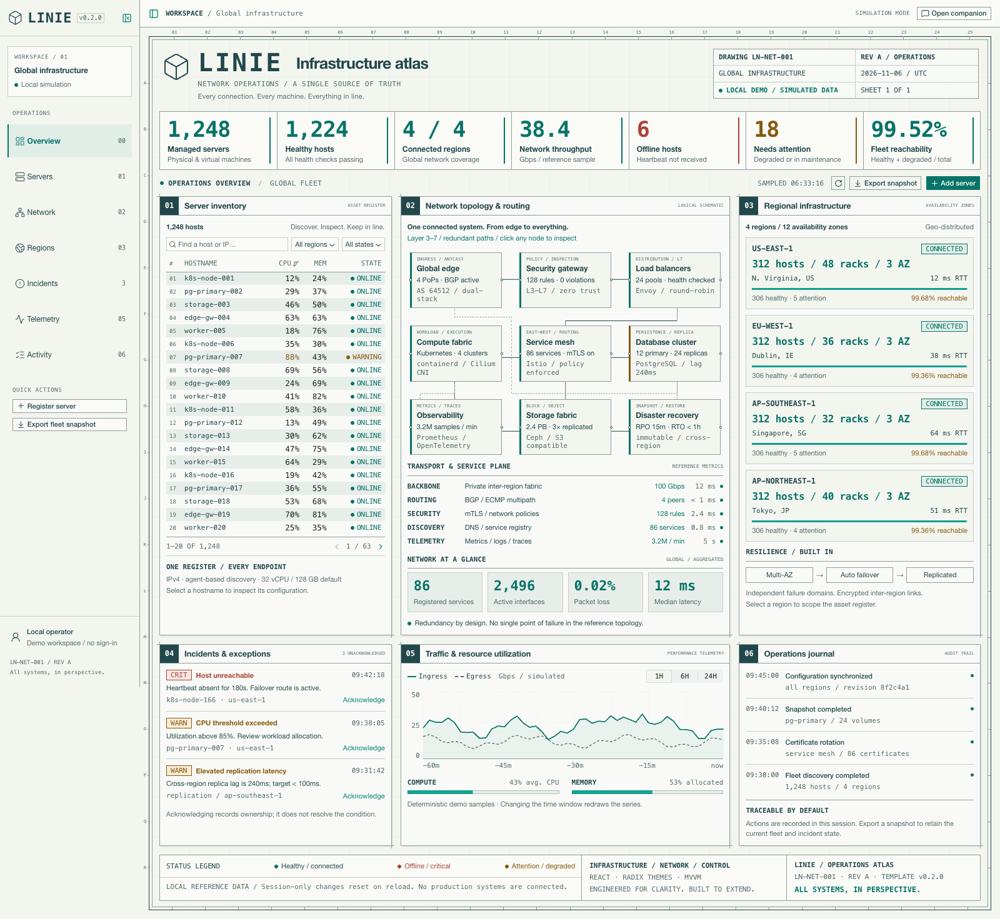

<p align="center">
  
</p>
<h1 align="center">Linie</h1>
<p align="center">把工程校核图做成网络运维控制台的前端模板，自带模拟主机清单与只读运维助手。</p>
<p align="center"><a href="https://linie.hexly.ai">站点</a> · <a href="docs/README.en.md">English</a></p>

## 这是什么

Linie 是一套能直接跑起来的前端模板，用来起步做大型网络运维（Network Operations）控制台。它把一张工程校核图改造成操作界面：暖色纸面、青墨线条、坐标标尺、编号面板和图纸标题栏，里面装着一套确定性生成的参考数据——1,248 台主机、4 个区域、9 个拓扑组件、3 条事件和 4 条运维日志。

它是模板，不是监控产品：没有真实基础设施管理后端、没有基础设施凭据，也不连接任何真实系统。改动只存在于当前浏览器会话，刷新即恢复参考数据；重新采样流量不会丢掉会话内的修改。界面文案目前只有英文。



右侧运维助手同样是模拟的：回复由本地模板根据当前机队生成，不调用 AI 服务，也不会执行命令。关闭面板不会清空对话。侧栏与图纸标题栏显示的版本号来自 `package.json`。

[查看运维助手](docs/companion.png)

## 功能

- **主机清单**：1,248 台确定性主机，支持主机名、IP 与角色搜索，区域与状态筛选，CPU 排序，分页，以及逐台检查配置。
- **主机注册**：校验主机名、IPv4、区域、角色与重复身份后，新主机出现在清单开头。
- **网络拓扑**：9 个可点击组件，覆盖接入、安全、计算、存储与恢复。
- **区域视图**：4 个区域，带派生健康汇总，点一下就能把清单收敛到该区域。
- **事件与例外**：确认事件会记一条审计并认领归属，但不会假装问题已经解决。
- **流量与资源**：1 小时、6 小时、24 小时模拟流量，可重新采样，并展示机队利用率。
- **运维日志**：会话活动、主机注册、维护状态，以及可下载的 JSON 快照。
- **工作台外壳**：侧栏默认展开、可收起；运维助手默认收起，支持基于当前机队的多轮模拟对话，包括主机名检查与区域对比。

维护状态只对在线或已在维护中的主机开放；确认和维护都只改本地演示状态，不会下发到任何系统。

## 使用

模板以「复制仓库、替换数据」的方式使用：

```sh
git clone https://github.com/nocoo/linie.git
cd linie
npm ci
npm run dev
```

开发服务器跑在 `127.0.0.1:7064`，浏览器通过本机 Caddy 打开 <https://linie.dev.hexly.ai>。

替换数据从 Model/ViewModel 边界开始：`src/models/infrastructure.ts` 放领域类型、fixture、校验与纯函数，`src/viewmodels/useAtlasViewModel.ts` 放会话状态、派生汇总和命令。要接真实 API 时就在这一层加上加载状态、失败处理、授权和服务端分页，视图不需要跟着改。演示里的维护与事件确认不是带权限校验的生产操作，接后端时按需替换。

## 开发

### 环境要求

- Node.js `^22.23.0`、`^24.22.0` 或 `>=26.12.0`（来自 `package.json` 的 `engines`）
- npm 11（`packageManager` 声明为 `npm@11.20.0`）；仓库提交了 lockfile，安装用 `npm ci`
- 浏览器测试需要本机已安装 Google Chrome

```sh
npm ci
npm run dev        # cf dev：Vite + workerd，监听 127.0.0.1:7064
npm run build      # tsc 编译并用 cf 构建，产物在 .cloudflare/output/v0/
npm run preview    # Worker 感知的本地预览
npm run lint       # Biome，出现告警即失败
npm run typecheck  # 严格 TypeScript 检查
npm run format     # 应用 Biome 格式化与安全修复
```

在 Herdr 里用项目自己的 `dev server` tab 启动开发服务器，不要放到后台进程。

### 目录结构

```text
src/
  models/       领域类型、fixture、校验与纯函数
  viewmodels/   应用状态、派生汇总与命令
  views/        六个面板、页头、页脚与对话框组合
  components/   制图框架、编号面板、状态与对话框机制
  styles/       设计 token 与响应式表现
worker/         /api/live 与静态资源兜底
docs/           架构、部署与 CI 说明
```

Views 只消费 ViewModel，不持有基础设施业务规则；权限校验与真正的生产操作不应该留在展示层。

### 部署

Cloudflare Worker 同时托管静态资源和匿名健康端点。配置在 `cloudflare.config.ts`，部署用 `cf`，没有 Wrangler 配置。

```sh
npm run check
npm run deploy:dry-run    # 构建并校验预构建产物，不上传
npm run deploy            # 需要已登录的 cf 配置，且只有明确授权时才发布
npm run verify:deployment # 校验线上版本与入口资源哈希
```

项目没有数据库、KV、AI 绑定或密钥。生产域名是 <https://linie.hexly.ai>，`workers.dev` 和预览 URL 均关闭。完整流程、端口分配与本地 HTTPS 见[部署与版本管理](docs/deployment.md)，流水线与凭据见 [CI 与自动部署](docs/ci.md)。

`GET /api/live` 返回清单版本和 Worker 存活状态，带 `Cache-Control: no-store`；`HEAD` 状态相同但没有正文，其他方法返回 405，未知的 `/api/*` 路径返回 JSON 404，而不是 SPA 兜底页。它只证明这一版 Worker 能响应，不声明模拟图谱背后的基础设施健康。

## 测试

```sh
npm run test           # Vitest：模型、视图模型、Worker 路由与部署校验逻辑
npm run test:coverage  # 同样的测试并输出覆盖率报告
npm run test:e2e       # Playwright 桌面与手机流程
npm run check          # lint + typecheck + 覆盖率测试
```

`npm run test:e2e` 需要已安装 Chrome，并且本地已经有一个运行中的服务：先按上面的方式 `npm run dev`，默认访问 `http://127.0.0.1:7064`，也可以用 `PLAYWRIGHT_BASE_URL` 指向其他来源。设置 `CI=true` 时 Playwright 会自己构建，并在 `127.0.0.1:17064` 启动隔离预览，不复用已在运行的服务。全新 CI 环境需要先运行 `npx playwright install --with-deps chromium`，安装 Playwright 管理的完整 Chromium 与运行依赖。走本机 HTTPS 验收时：

```sh
NODE_EXTRA_CA_CERTS="$(mkcert -CAROOT)/rootCA.pem" \
  PLAYWRIGHT_BASE_URL=https://linie.dev.hexly.ai npm run test:e2e
```

这条命令只读取本机已有的 mkcert CA 文件，不修改信任设置，也不关闭 TLS 校验。

浏览器测试覆盖图谱渲染与页面无横向溢出、清单筛选与空结果分页、注册校验、主机检查与维护切换及焦点回归、拓扑与区域联动、事件确认、流量时间窗切换与快照导出、侧栏与助手的交互、自动 WCAG A/AA 检查，以及 360–2048px 视口重排。健康端点另有独立的契约测试，检查状态码、缓存头、版本与方法限制。

## 技术栈

| 技术                  | 用途                                  |
| --------------------- | ------------------------------------- |
| React 19              | 六个面板、工作台外壳与对话框          |
| TypeScript            | 严格模式下的源码与共享契约            |
| Vite                  | 开发服务器与生产构建                  |
| Cloudflare Workers    | 静态资源托管与匿名健康端点            |
| Radix Themes          | 可访问的标准控件，保持图纸的方形几何  |
| Lucide                | 界面图标                              |
| Biome                 | 静态检查与格式化                      |
| Vitest                | 模型、视图模型、Worker 与部署校验测试 |
| Playwright + axe-core | 浏览器流程与自动化无障碍检查          |

## 文档

- [架构与数据语义](docs/architecture.md) — 视觉契约、扩展点与演示边界。
- [部署与版本管理](docs/deployment.md) — 环境、端口、HTTPS、Cloudflare 与版本生命周期。
- [CI 与自动部署](docs/ci.md) — 共用工作流、生产凭据与发布校验。
- [CHANGELOG.md](CHANGELOG.md) — 版本记录。
- [Retrospective.md](Retrospective.md) — 事故与交接记录。

## 许可证

MIT，见 [LICENSE](LICENSE)。Copyright (c) 2026 Zheng Li。
