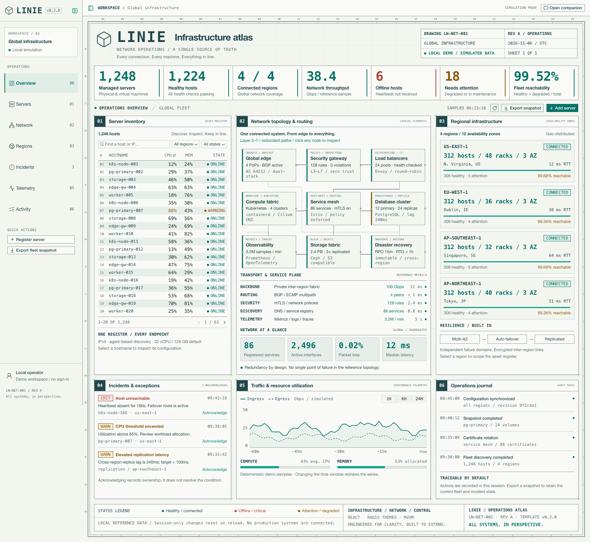

<h1 align="center">Linie</h1>
<p align="center">A frontend template that turns an engineering verification drawing into a network operations console, with a simulated fleet and a read-only companion.</p>
<p align="center"><a href="https://linie.hexly.ai">Website</a> · <a href="../README.md">简体中文</a></p>

## What it does

Linie is a working frontend template for starting a large-scale network operations console. It converts a single engineering verification drawing into an interface: warm paper, teal ink, coordinate rulers, numbered panels and a drawing title block, filled with one deterministic reference data set — 1,248 hosts, 4 regions, 9 topology components, 3 incidents and 4 journal entries.

It is a template, not a monitoring product. There is no backend, no credential and no connection to a real system. Changes last for the current browser session only; reloading restores the reference data, while resampling telemetry keeps in-session edits. Interface copy is English-only today.



The operations companion on the right is simulated as well: replies come from local templates built from the current fleet, it never calls an AI service and never executes a command. Closing the panel keeps the conversation. The version shown in the sidebar and the drawing title block is read from `package.json`.

[View the operations companion](companion.png)

## Features

- **Server inventory:** 1,248 deterministic hosts with hostname, IP and role search, region and status filters, CPU sorting, pagination and per-host configuration inspection.
- **Server registration:** hostname, IPv4, region, role and duplicate identity are validated, then the new host appears at the top of the register.
- **Network topology:** nine clickable components spanning ingress, security, compute, storage and recovery.
- **Regional infrastructure:** four regions with derived health summaries; selecting one scopes the inventory to it.
- **Incidents:** acknowledging an incident writes an audit entry and claims ownership without pretending the condition is resolved.
- **Traffic and resources:** simulated 1-hour, 6-hour and 24-hour traffic with resampling, plus fleet utilization.
- **Operations journal:** session activity, server registration, maintenance state and a downloadable JSON snapshot.
- **Workspace shell:** the sidebar starts expanded and can close; the operations companion starts folded and supports simulated multi-turn conversations about the current fleet, including hostname inspection and regional comparisons.

Maintenance is limited to online or already-maintained hosts, and both acknowledgement and maintenance only change local demo state; nothing is dispatched to a system.

## Usage

Use the repository as a template: copy it, then replace the data.

```sh
git clone https://github.com/nocoo/linie.git
cd linie
npm ci
npm run dev
```

The development server listens on `127.0.0.1:7064`; open <https://linie.dev.hexly.ai> through the local Caddy proxy.

Start replacing data at the Model/ViewModel boundary: `src/models/infrastructure.ts` owns domain types, fixtures, validation and pure operations, and `src/viewmodels/useAtlasViewModel.ts` owns session state, derived summaries and commands. When a real API exists, add loading, transport failures, authorization and server-side pagination there; the views do not need to change. The demo maintenance and acknowledgement actions are not permission-checked production operations, so replace them when a backend is defined.

## Development

### Requirements

- Node.js `^22.23.0`, `^24.22.0` or `>=26.12.0` (from `package.json` `engines`)
- npm 11 (`packageManager` is `npm@11.20.0`); the lockfile is committed, so install with `npm ci`
- Google Chrome installed locally for the browser tests

```sh
npm ci
npm run dev        # cf dev: Vite + workerd on 127.0.0.1:7064
npm run build      # tsc then a cf build; output in .cloudflare/output/v0/
npm run preview    # Worker-aware local preview
npm run lint       # Biome, warnings rejected
npm run typecheck  # strict TypeScript
npm run format     # apply Biome formatting and safe fixes
```

Inside Herdr, run the development server in the project's own `dev server` tab instead of as a background process.

### Layout

```text
src/
  models/       Domain types, fixtures, validation and pure operations
  viewmodels/   Application state, derived summaries and commands
  views/        Six panels, header, footer and dialog composition
  components/   Drawing frame, numbered panels, status and dialog mechanics
  styles/       Design tokens and responsive presentation
worker/         /api/live and the static-asset fallback
docs/           Architecture, deployment and CI notes
```

Views consume the ViewModel and do not own infrastructure business rules; permission checks and real production operations do not belong in the presentation layer.

### Deployment

A Cloudflare Worker serves both the static assets and the anonymous health endpoint. `cloudflare.config.ts` is the configuration and deployment uses `cf`; there is no Wrangler configuration.

```sh
npm run check
npm run deploy:dry-run    # build and validate the prebuilt output without uploading
npm run deploy            # needs an authenticated cf profile, and explicit authorization
npm run verify:deployment # verify the public version and entry-asset hashes
```

No database, KV namespace, AI binding or secret is provisioned. Production is <https://linie.hexly.ai>; workers.dev and preview URLs are disabled. Environments, ports and local HTTPS are in [deployment and versions](deployment.md); the pipeline and credentials are in [CI and continuous deployment](ci.md).

`GET /api/live` returns the manifest version and Worker liveness with `Cache-Control: no-store`. `HEAD` returns the same status without a body, other methods return 405, and unknown `/api/*` paths return JSON 404 instead of the SPA shell. The endpoint proves that this Worker revision can answer; it does not claim healthy infrastructure behind the simulated atlas.

## Tests

```sh
npm run test           # Vitest: models, view models, Worker routing and deployment-verification logic
npm run test:coverage  # the same tests with a coverage report
npm run test:e2e       # Playwright desktop and mobile journeys
npm run check          # lint + typecheck + coverage tests
```

`npm run test:e2e` needs an installed Chrome and an already running server: start `npm run dev` as above, then tests target `http://127.0.0.1:7064` unless `PLAYWRIGHT_BASE_URL` points elsewhere. With `CI=true`, Playwright builds the app and starts its own isolated preview on `127.0.0.1:17064` instead of reusing a running server. For local HTTPS acceptance:

```sh
NODE_EXTRA_CA_CERTS="$(mkcert -CAROOT)/rootCA.pem" \
  PLAYWRIGHT_BASE_URL=https://linie.dev.hexly.ai npm run test:e2e
```

That command only reads the existing mkcert CA file; it does not change trust settings or disable TLS verification.

The browser journeys cover atlas rendering without horizontal overflow, inventory filtering with empty results and pagination, registration validation, host inspection with maintenance toggling and focus restoration, topology and region scoping, incident acknowledgement, telemetry window switching with snapshot export, sidebar and companion behaviour, automated WCAG A/AA checks, and reflow at 360–2048px viewports. The health endpoint has its own contract test for status, cache headers, version and allowed methods.

## Stack

| Technology            | Role                                                                 |
| --------------------- | -------------------------------------------------------------------- |
| React 19              | Six panels, workspace shell and dialogs                              |
| TypeScript            | Source and shared contracts in strict mode                           |
| Vite                  | Development server and production build                              |
| Cloudflare Workers    | Static asset hosting and the anonymous health endpoint               |
| Radix Themes          | Accessible standard controls that keep the drawing's square geometry |
| Lucide                | Interface icons                                                      |
| Biome                 | Static checks and formatting                                         |
| Vitest                | Model, view-model, Worker and deployment-verification tests          |
| Playwright + axe-core | Browser journeys and automated accessibility checks                  |

## Documentation

- [Architecture and data semantics](architecture.md) — visual contract, extension points and demo boundaries.
- [Deployment and version management](deployment.md) — environments, ports, HTTPS, Cloudflare and the version lifecycle.
- [CI and continuous deployment](ci.md) — shared workflows, production credentials and publication verification.
- [CHANGELOG.md](../CHANGELOG.md) — release history.
- [Retrospective.md](../Retrospective.md) — incident and handoff notes.

## License

MIT; see [LICENSE](../LICENSE). Copyright (c) 2026 Zheng Li.
